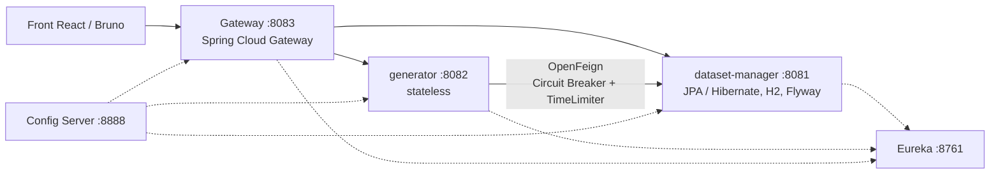

# Dataset Generator

Générateur de jeux de données de test, en microservices **Java 25 / Spring Boot 4 / Spring Cloud**. L'utilisateur décrit ses tables (colonnes, types, contraintes, sous-tables) ; le service génère des données réalistes et reliées entre elles, puis les exporte en SQL, JSON, CSV ou XML.

Projet du Master 2 MIAGE MBDS (Université Côte d'Azur), réalisé en binôme. La documentation détaillée de chaque service est dans [`ms_dataset/README.md`](ms_dataset/README.md).

## Architecture



- **dataset-manager** garde la définition des projets : tables, colonnes, types et contraintes.
- **generator** ne stocke rien. Il lit la définition par OpenFeign, génère les lignes avec Datafaker et les envoie au client.
- La gateway, l'annuaire Eureka et le serveur de configuration complètent l'architecture. La configuration de chaque service est centralisée dans [`ms_dataset/config-repo`](ms_dataset/config-repo).

## Stack technique

- **Backend** : Java 25, Spring Boot 4, Spring Data JPA / Hibernate 7, H2, Flyway, Datafaker
- **Frontend** : React 19, TypeScript, Vite
- **Microservices** : Spring Cloud Gateway, Eureka, Config Server, OpenFeign, Resilience4J
- **Tests** : JUnit 5, AssertJ, Testcontainers, Vitest, collection d'API Bruno
- **Déploiement** : Docker, Docker Compose

## Points techniques

**Plus de 40 fois moins de requêtes SQL au chargement.** Le générateur charge un projet complet avant chaque aperçu et chaque export. La couche JPA d'origine déclenchait une requête par table, par colonne et par type (problème N+1). Sur un projet de test de 10 tables et 45 colonnes :

| | Avant | Après |
|---|---|---|
| Requêtes pour charger le projet | 87 | 2 |
| Requêtes pour le créer | 210 | 29 |

Le type et les contraintes d'une colonne sont stockés en JSON au lieu de trois tables. Le projet se charge en un seul `join fetch`, les identifiants viennent de séquences, ce qui permet d'envoyer les insertions par lots. Le schéma est versionné avec Flyway. Un test mesure le nombre de requêtes avec les statistiques Hibernate et échoue s'il remonte.

**Données relationnelles.** Chaque table générée a une clé `id`, et chaque sous-table une clé étrangère vers une ligne existante de sa table parente. L'export SQL crée les tables avec leurs clés avant d'insérer les lignes : il se charge tel quel dans PostgreSQL, contraintes actives. Un test le vérifie dans un vrai PostgreSQL (Testcontainers).

**Un million de lignes avec 64 Mo de mémoire.** L'export écrit chaque ligne dans la réponse HTTP dès qu'elle est générée, sans fichier temporaire. Dans une JVM limitée à 64 Mo, un million de lignes passent. L'ancienne version, qui construisait tout en mémoire, s'arrête en `OutOfMemoryError`.

**Résilience.** L'appel du générateur vers dataset-manager est protégé par un circuit breaker et un TimeLimiter Resilience4J, configurés dans `config-repo`. En cas de panne, l'export répond 503 avec une réponse de repli (`PARTIAL`) et l'aperçu une réponse partielle, sans jamais renvoyer de stacktrace ni de fichier vide. Un projet inexistant reste une erreur 404 et n'ouvre pas le circuit. Un test d'intégration rejoue ces scénarios contre un faux dataset-manager, avec la configuration réelle.

## Lancer le projet

Prérequis : Java 25 et Maven. Pas besoin de Docker : la base est un fichier H2.

Démarrer les services dans cet ordre, chacun dans son propre terminal, avec `mvn spring-boot:run` lancé dans son dossier sous `ms_dataset/`. Le serveur de configuration doit répondre avant les autres : un service lancé sans lui s'arrête avec un message explicite au lieu de démarrer mal configuré.

1. `config_service`
2. `discovery_server`
3. `dataset_manager_service`
4. `generator_service`
5. `gateway`

Puis l'interface, depuis `ms_dataset/frontend/` : `npm install`, puis `npm run dev`, et ouvrir http://localhost:5173.

Avec Docker, tout se lance en une commande depuis `ms_dataset/` : `docker-compose up -d --build`.

## Tests

Dans `ms_dataset/dataset_manager_service` puis `ms_dataset/generator_service` :

```bash
mvn test
```

dataset-manager compte 12 tests (H2 en mémoire, dont des appels HTTP en JSON), le générateur 19, dont un qui demande Docker pour lancer PostgreSQL. Le front a ses tests Vitest : `npm test` dans `ms_dataset/frontend`.

La collection d'API Bruno (cas passants, erreurs, scénario complet) est dans [`ms_dataset/dataset_manager_service/tests/bruno-collection`](ms_dataset/dataset_manager_service/tests/bruno-collection).

## Auteurs

- Mamitiana Rakotoson
- Mohamed Amine Moumeni

Master 2 MIAGE MBDS, Université Côte d'Azur, 2025/2026.
