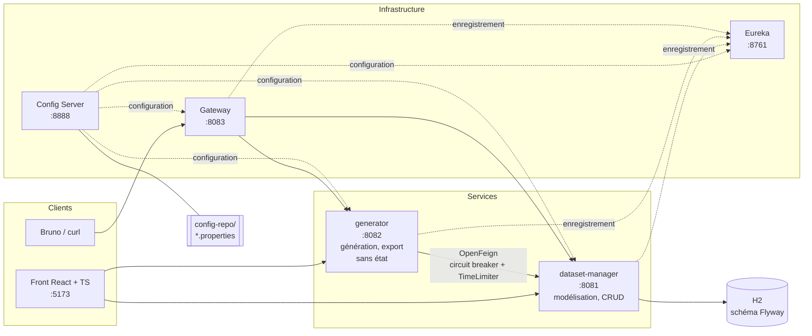
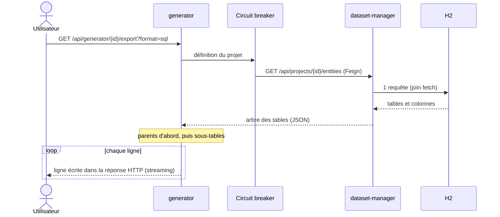
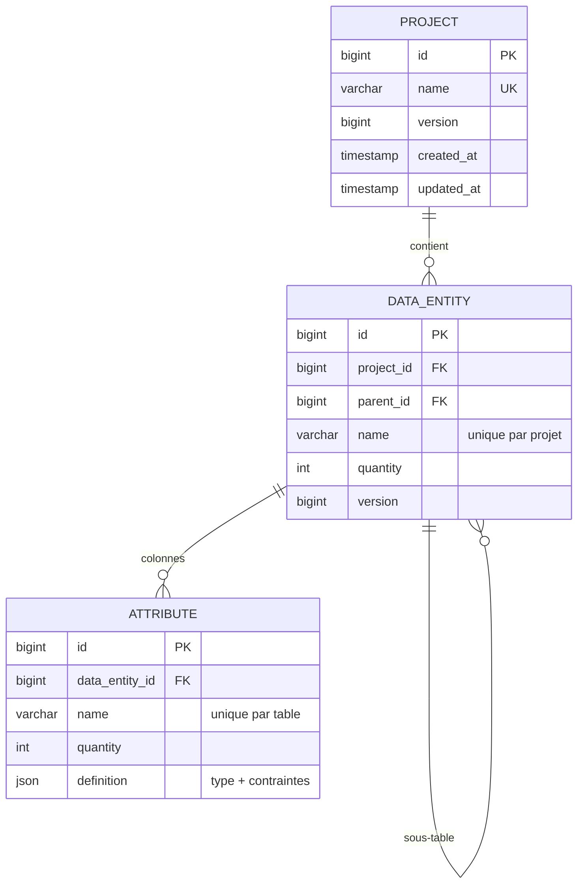
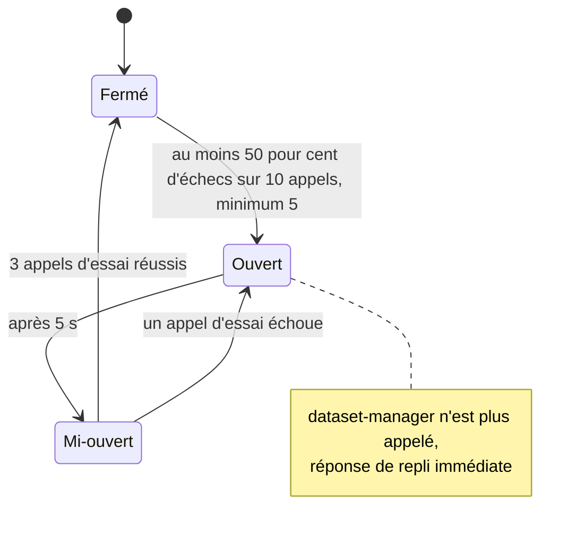

# Dataset Generator

[](https://github.com/MamitianaRak/dataset-generator/actions/workflows/ci.yml)

Générateur de jeux de données de test, en microservices **Java 25 / Spring Boot 4 / Spring Cloud**, avec une interface **React + TypeScript**. L'utilisateur décrit ses tables (colonnes, types, contraintes, sous-tables) ; le service génère des données réalistes, reliées entre elles par des clés étrangères, et les exporte en SQL, JSON, CSV ou XML.

```sql
-- Extrait d'un export SQL réel : il se charge tel quel dans PostgreSQL, clés étrangères actives.
CREATE TABLE "customer" (
    "id" bigint primary key,
    "email" text,
    "age" bigint
);
INSERT INTO "customer" ("id", "email", "age") VALUES (1, 'romain.aubry@yahoo.fr', 45);
INSERT INTO "customer" ("id", "email", "age") VALUES (2, 'adrien.chevalier@hotmail.fr', 90);

CREATE TABLE "order" (
    "id" bigint primary key,
    "customer_id" bigint,
    "total" double precision,
    "status" text,
    foreign key ("customer_id") references "customer" ("id")
);
```

## Sommaire

- [Fonctionnalités](#fonctionnalités)
- [Architecture](#architecture)
- [Points techniques](#points-techniques)
- [Stack technique](#stack-technique)
- [Lancer le projet](#lancer-le-projet)
- [API](#api)
- [Tests & QA](#tests--qa)
- [Structure du dépôt](#structure-du-dépôt)
- [Limites connues](#limites-connues)

## Fonctionnalités

- **Modélisation** : projets, tables et colonnes (texte, entier, décimal, booléen, date, énumération), bornes min/max et listes de valeurs autorisées.
- **Tables reliées** : une sous-table reçoit une colonne `<parent>_id` qui pointe vers une ligne existante de sa table parente.
- **Données réalistes** : le générateur reconnaît le domaine d'une colonne à son nom (`email`, `firstName`, `city`, `price`…) avec Datafaker, en français ; les contraintes explicites restent prioritaires.
- **Aperçu** : jusqu'à 100 lignes par table, sans générer le jeu complet.
- **Export** : SQL (tables, clés primaires et étrangères, puis lignes), JSON, CSV, XML, envoyés en streaming jusqu'à 1 000 000 de lignes par table.
- **Résilience** : si le service de modélisation tombe, le générateur répond avec un repli explicite, jamais une stacktrace ni un fichier vide.

## Architecture



| Composant | Port | Rôle |
|---|---|---|
| `config_service` | 8888 | Spring Cloud Config (profil `native`) : sert les fichiers de [`ms_dataset/config-repo`](ms_dataset/config-repo) |
| `discovery_server` | 8761 | Annuaire Eureka |
| `gateway` | 8083 | Spring Cloud Gateway : `/DATASET-MANAGER/**`, `/GENERATOR-SERVICE/**` et routes découvertes |
| `dataset_manager_service` | 8081 | Projets, tables, colonnes ; JPA / Hibernate, H2, Flyway |
| `generator_service` | 8082 | Lit la définition par OpenFeign, génère et exporte ; ne stocke rien, donc plusieurs instances possibles |
| `frontend` | 5173 | React 19 + TypeScript + Vite |

### Parcours d'un export



La définition est lue avant d'écrire la réponse : une erreur (projet inconnu, service indisponible) peut encore être renvoyée avec son code HTTP. Ensuite, les lignes partent au fil de la génération ; seuls le nombre de lignes de chaque table parente et un échantillon de 1 000 lignes servant à fixer les types des colonnes restent en mémoire.

### Modèle de données de dataset-manager



Le type et les contraintes d'une colonne sont une valeur propre à la colonne : ils sont stockés dans une colonne JSON plutôt que dans trois tables. Les suppressions en cascade sont faites par la base (`on delete cascade`), et chaque table porte un verrou optimiste (`version`).

### Circuit breaker



| Situation | Aperçu | Export |
|---|---|---|
| dataset-manager répond | 200, données | 200, fichier en streaming |
| Projet inexistant | 404 | 404 (ne compte pas comme une panne) |
| dataset-manager arrêté, lent (plus de 10 s) ou circuit ouvert | 200, `{"status": "PARTIAL", "data": []}` et un message | 503, même réponse de repli |

Les réglages sont dans `config-repo/generator.properties`. Le circuit breaker est nommé d'après le client Feign (`datasetManagerClient`) : par défaut, Spring Cloud OpenFeign en crée un par méthode, et ces réglages ne s'appliquaient pas.

## Points techniques

**Plus de 40 fois moins de requêtes SQL au chargement.** Le générateur charge un projet complet avant chaque aperçu et chaque export. La couche JPA d'origine déclenchait une requête par table, par colonne et par type (problème N+1). Sur un projet de test de 10 tables et 45 colonnes :

| | Avant | Après |
|---|---|---|
| Requêtes pour charger le projet | 87 | 2 |
| Requêtes pour le créer | 210 | 29 |

Le projet se charge en un seul `join fetch`, puis l'arbre est reconstruit en mémoire ; les identifiants viennent de séquences, ce qui permet d'envoyer les insertions par lots. Un test mesure le nombre de requêtes avec les statistiques Hibernate et échoue s'il remonte.

**Un million de lignes avec 64 Mo de mémoire.** Dans une JVM limitée à 64 Mo, l'export en streaming d'un million de lignes passe ; l'ancienne version, qui construisait tout en mémoire puis écrivait un fichier temporaire jamais supprimé, s'arrête en `OutOfMemoryError`. Un test lance chaque cas dans une JVM séparée.

**Un export SQL réellement chargeable.** L'export crée chaque table avec sa clé primaire et sa clé étrangère, parents d'abord, avec des noms protégés (`"order"` est un mot réservé). Le type SQL d'une colonne est déduit des valeurs générées, pas du type déclaré. Un test charge un export de 4 200 lignes dans un vrai PostgreSQL (Testcontainers) et vérifie les jointures.

**Une configuration vérifiée en conditions réelles.** Lancer la stack complète a révélé trois défauts que les tests unitaires ne voyaient pas : la gateway ne chargeait aucune route (Spring Cloud 2025 lit `spring.cloud.gateway.server.webflux.*` et ignorait les anciennes clés), Jackson 3 refusait un nombre facultatif absent, et le générateur ignorait les bornes d'une colonne dont il reconnaissait le nom. Les trois sont corrigés et couverts par des tests.

## Stack technique

- **Backend** : Java 25, Spring Boot 4, Spring Data JPA / Hibernate 7, H2, Flyway, Datafaker, MapStruct, Springdoc OpenAPI
- **Microservices** : Spring Cloud Gateway, Eureka, Config Server, OpenFeign, Resilience4J
- **Frontend** : React 19, TypeScript, Vite
- **Tests** : JUnit 5, AssertJ, Testcontainers, Vitest, Bruno
- **Outillage** : Maven, Docker, Docker Compose, GitHub Actions

## Lancer le projet

### En local

Prérequis : Java 25, Maven et Node.js 22. Aucune base à installer : dataset-manager utilise un fichier H2.

Lancer chaque service dans son propre terminal, avec `mvn spring-boot:run` dans son dossier sous `ms_dataset/`, **le serveur de configuration en premier** : un service lancé sans lui s'arrête avec un message explicite au lieu de démarrer mal configuré.

1. `config_service`
2. `discovery_server`
3. `dataset_manager_service`
4. `generator_service`
5. `gateway`

Puis l'interface :

```bash
cd ms_dataset/frontend
npm install
npm run dev
```

| Adresse | |
|---|---|
| http://localhost:5173 | Interface |
| http://localhost:8761 | Tableau de bord Eureka |
| http://localhost:8081/api/swagger-ui/index.html | Documentation de l'API (Swagger) |
| http://localhost:8081/api/h2-console | Console H2 (`jdbc:h2:file:./data/dataset-manager`, utilisateur `sa`) |

### Avec Docker

Depuis `ms_dataset/`, tout se lance en une commande ; les healthchecks imposent l'ordre de démarrage.

```bash
docker-compose up -d --build     # première fois : 5 à 10 minutes
docker-compose ps                # 6 conteneurs "Up"
docker-compose logs -f generator-service
docker-compose down              # arrêter (docker-compose down -v efface aussi la base)
```

## API

Les URL sont données en direct ; via la gateway, préfixer par `http://localhost:8083/DATASET-MANAGER` ou `http://localhost:8083/GENERATOR-SERVICE`.

### dataset-manager (`http://localhost:8081/api`)

| Méthode | Endpoint | Description |
|---|---|---|
| POST | `/projects` | Créer un projet |
| GET | `/projects` | Lister les projets |
| GET | `/projects/{id}` | Détail d'un projet |
| PUT | `/projects/{id}` | Renommer un projet |
| DELETE | `/projects/{id}` | Supprimer un projet, ses tables et colonnes |
| POST | `/projects/{id}/entities` | Ajouter une table, avec ses sous-tables éventuelles |
| GET | `/projects/{id}/entities` | Lister les tables d'un projet, en arbre |
| GET | `/entities/{id}` | Détail d'une table |
| PUT | `/entities/{id}` | Modifier une table (colonnes rapprochées par nom) |
| DELETE | `/entities/{id}` | Supprimer une table et ses sous-tables |
| POST | `/entities/{id}/sub-entities` | Ajouter une sous-table à une table existante |

### generator (`http://localhost:8082/api/generator`)

| Méthode | Endpoint | Description |
|---|---|---|
| GET | `/{projectId}/preview` | Aperçu JSON, 100 lignes par table au plus |
| GET | `/{projectId}/export?format=sql\|json\|csv\|xml` | Export complet, en streaming |

### Exemple

```bash
curl -X POST http://localhost:8081/api/projects/1/entities \
  -H "Content-Type: application/json" \
  -d '{
    "name": "customer",
    "quantity": 200,
    "attributes": [
      {"name": "email", "type": {"typeClass": "StringType"}},
      {"name": "age", "type": {"typeClass": "IntegerType"},
       "constraints": [{"constraintClass": "MinMaxConstraint", "min": 18, "max": 90}]},
      {"name": "segment", "type": {"typeClass": "EnumType", "values": ["B2B", "B2C"]}}
    ],
    "subEntities": [
      {"name": "order", "quantity": 1000,
       "attributes": [{"name": "total", "type": {"typeClass": "FloatType"}}]}
    ]
  }'
```

La quantité d'une sous-table est son nombre total de lignes : ici 1 000 commandes, chacune rattachée à l'un des 200 clients.

| Type (`typeClass`) | Contraintes possibles (`constraintClass`) |
|---|---|
| `StringType`, `IntegerType`, `FloatType`, `BooleanType`, `DateType`, `EnumType` (`values`) | `MinMaxConstraint` (`min`, `max`), `EnumConstraint` (`allowed`) |

| Code | Situation |
|---|---|
| 400 | JSON illisible, validation échouée (quantité hors de 1 à 1 000 000, min supérieur à max), type inconnu, format d'export inconnu |
| 404 | Projet ou table introuvable |
| 409 | Nom déjà utilisé (projet, table dans un projet, colonne dans une table) ou modification concurrente |
| 503 | Génération : dataset-manager indisponible (réponse de repli `PARTIAL`) |

## Tests & QA

### Tests automatisés

| Module | Tests | Ce qu'ils couvrent |
|---|---|---|
| dataset-manager | 12 | Nombre de requêtes SQL, persistance (JSON, cascade, verrou optimiste, noms uniques), API en JSON réel |
| generator | 19 | Données relationnelles, contraintes, mémoire (1 million de lignes, 64 Mo), export chargé dans PostgreSQL, scénarios de panne |
| frontend | 5 | Conversions formulaire ↔ API, arbre des tables |

```bash
cd ms_dataset/<service> && mvn test       # le test PostgreSQL du générateur demande Docker
cd ms_dataset/frontend && npm test
```

La CI GitHub Actions lance les tests des 5 services et du front, et le build de production du front, à chaque push et à chaque pull request.

### Collection d'API Bruno

La collection [`ms_dataset/dataset_manager_service/tests/bruno-collection`](ms_dataset/dataset_manager_service/tests/bruno-collection) teste l'API de bout en bout, services lancés. Chaque requête contient des assertions.

| Dossier | Requêtes | Contenu |
|---|---|---|
| `UnitTests` | 13 | Chaque endpoint avec des données valides |
| `ErrorTests` | 8 | 400 (projet sans nom, min > max, type inconnu), 404 (projet, table, suppression), 409 (avec sa requête de préparation) |
| `IntegrationTests` | 6 | Scénario chaîné par variables : créer, ajouter une table, la modifier, aperçu, export JSON, nettoyage ; rejouable à l'infini |

```bash
npm install -g @usebruno/cli
cd ms_dataset/dataset_manager_service/tests/bruno-collection
bru run --env MicroService                                  # toute la collection
bru run IntegrationTests --env MicroService > report-cli.txt  # rapport d'exécution
```

L'environnement `MicroService` pointe vers dataset-manager (`baseUrl`, port 8081) et le générateur (`generatorUrl`, port 8082). Le dernier rapport enregistré est [`report-cli.txt`](ms_dataset/dataset_manager_service/tests/bruno-collection/report-cli.txt).

### Scénario de panne

1. Lancer les services, créer un projet et une table, demander un aperçu : `200`, `"status": "OK"`.
2. Arrêter brutalement `dataset_manager_service`.
3. Redemander l'aperçu : `200`, `"status": "PARTIAL"`, `"data": []` et un message ; l'export répond `503` avec la même réponse de repli. Après 5 échecs, le circuit s'ouvre et la réponse est immédiate.

## Structure du dépôt

```
ms_dataset/
  config_service/            Spring Cloud Config Server
  config-repo/               configuration de chaque service
  discovery_server/          Eureka
  gateway/                   Spring Cloud Gateway
  dataset_manager_service/   modélisation : JPA, Flyway (src/main/resources/db/migration), tests Bruno
  generator_service/         génération, exports en streaming, client Feign résilient
  frontend/                  React + TypeScript (src/api, src/lib, src/components)
  docker-compose.yml
.github/workflows/ci.yml
```

## Limites connues

- Le champ `generator` d'une colonne (`FakerGenerator`, `SequentialGenerator`) est accepté par l'API mais n'est ni enregistré ni utilisé : la valeur dépend du nom, du type et des contraintes de la colonne.
- Les distributions statistiques (loi normale, probabilités par valeur d'une énumération) ne sont pas gérées.
- Les bornes d'un décimal sont arrondies à l'entier lors de la génération.
- Pas d'authentification : l'application est prévue pour un usage local.

## Auteurs

- Mamitiana Rakotoson
- Mohamed Amine Moumeni
